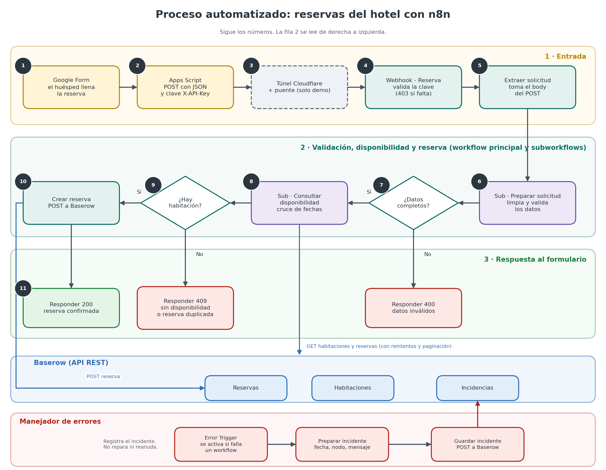

# Reservas de hotel automatizadas con n8n

> Curso: Automatización inteligente de procesos con n8n · EAM · 2026 II · Entrega del segundo corte

## 1. Descripción e integrantes

**Problema que resuelve:** Las solicitudes de reserva de un hotel se revisan a mano en un cuaderno o una hoja de cálculo para saber si hay una habitación libre en las fechas pedidas. Esto demora la respuesta, favorece reservas dobles sobre la misma habitación y obliga a transcribir datos con posibilidad de error.

**Solución:** Un conjunto de cuatro workflows en n8n que recibe la solicitud desde un Google Form, valida y limpia los datos, comprueba la disponibilidad por cruce de fechas, guarda la reserva en Baserow y responde de inmediato con el código HTTP que corresponde (200, 400, 403 o 409). Cuando falla algo de forma técnica, un workflow manejador de errores deja un incidente registrado en la tabla `Incidencias`.

**Integrantes:**

| Integrante | Responsabilidad |
|---|---|
| [Ana Sofia Ricardo] | [workflows, pruebas de disponibilidad y manejo de errores] |
| [Mariana Valencia Henao] | [bitácora y documentación] |
| [Luis Fernando Velasquez] | [bitácora y documentación] |
| [Juan Martin Garcia] | [presentación y diagramas] |

## 2. Alcance actual

**Funciones disponibles (implementado):**
- Entrada de reservas desde un **Google Form** mediante un script de Google Apps Script que envía un POST con JSON.
- Recepción por **Webhook** protegido con la cabecera `X-API-Key` (responde 403 si falta o es incorrecta).
- Limpieza y validación de datos en un subworkflow: recorta espacios, pasa el correo a minúsculas, convierte los huéspedes a número, calcula las noches y valida los campos.
- Consulta de disponibilidad en Baserow con la regla de cruce de fechas, con paginación y reintentos en las lecturas.
- Detección de reservas duplicadas (mismo correo, mismas fechas y habitación del tipo pedido).
- Creación de la reserva en Baserow y respuesta HTTP diferenciada.
- Manejador de errores que registra el incidente en la tabla `Incidencias`.

**Regla de disponibilidad:** una habitación está ocupada si `Entrada_reserva < Salida_pedida` y `Salida_reserva > Entrada_pedida`. Por eso una nueva reserva puede entrar el mismo día en que otra termina.


**Limitaciones principales:**
- El sistema corre en n8n local; solo es alcanzable desde Google mientras el túnel esté activo (uso de demo).
- La respuesta **503** para fallos técnicos del servicio externo aún no está implementada en el workflow principal.
- No hay modificación ni cancelación de reservas.

**Fuera de alcance / pendiente:**
- **Google Calendar:** la credencial OAuth se creó y se probó, pero el nodo no está integrado en el flujo. La disponibilidad se calcula solo con la tabla `Reservas`, y el campo `Evento_ID` queda vacío.
- El campo `id_envio` que llega del formulario no se usa todavía para detectar duplicados.

## 3. Arquitectura



**Recorrido de una reserva:**

1. **Google Form:** el huésped llena el formulario.
2. **Apps Script:** al enviar, hace un POST con JSON y la cabecera `X-API-Key`.
3. **Cloudflare Tunnel + puente** (solo para la demo): deja pasar únicamente `POST /webhook/reserva-hotel`.
4. **Webhook de n8n:** valida la clave.
5. **Preparar solicitud** (subworkflow): limpia y valida.
6. **Consultar disponibilidad** (subworkflow): lee Baserow.
7. **Crear reserva:** POST a Baserow.
8. **Respuesta:** 200, 400 o 409.

Si ocurre una falla técnica, el workflow **Manejador de errores** guarda un incidente en `Incidencias`.

| Workflow | Archivo | Responsabilidad |
|---|---|---|
| Hotel (principal) | `workflows/[Hotel.json]` | Recibe el webhook, extrae el cuerpo, llama a los dos subworkflows, decide la ruta y responde. Nodos: `Webhook - Reserva` → `Extraer solicitud` → `Llamar a Preparar solicitud` → `¿Datos completos?` → `Llamar a Consultar disponibilidad` → `¿Hay habitación?` → `Crear reserva` → respuesta. |
| Sub · Preparar solicitud | `workflows/[Sub_Preparar_solicitud.json]` | **Recibe:** nombre, email, fechas, huéspedes y tipo. **Devuelve:** `valido`, `errores`, `Cliente`, `Email`, `Entrada`, `Salida`, `Huespedes`, `Tipo`, `Noches`. No toca Baserow. |
| Sub · Consultar disponibilidad | `workflows/[Sub_Consultar_disponibilidad.json]` | **Recibe:** `Tipo`, `Entrada`, `Salida`, `Huespedes`, `Email`. **Devuelve:** `disponible`, `duplicada`, `motivo`, `habitacion`, `reserva_existente_id`. Hace dos GET a Baserow y aplica la regla de cruce de fechas. Solo lee. |
| Manejador de errores | `workflows/[Manejador_de_errores.json]` | Se activa con *Error Trigger*. Arma el incidente (fecha, workflow, nodo, mensaje, estado `pendiente_revision`) y lo guarda en `Incidencias`. Si no puede guardarlo, su ejecución queda en rojo. Registra, no repara. |

**Servicios externos:**

| Servicio | Para qué se usa | Nodo nativo o HTTP Request |
|---|---|---|
| Google Forms + Apps Script | Entrada de las reservas; emite el evento con `UrlFetchApp` | Externo al flujo (envía al Webhook) |
| Baserow (API REST) | Tablas `Habitaciones`, `Reservas` e `Incidencias`: lectura y escritura | HTTP Request con credencial Header Auth |
| Cloudflare Tunnel + `puente_reservas.cjs` | Hacer alcanzable el webhook local desde Google durante la demo | Fuera de n8n |

**Decisiones de diseño:**
- La validación devuelve `valido: false` en lugar de lanzar un error: un dato malo del huésped no es una falla técnica, responde 400 y no genera incidente.
- Los GET a Baserow tienen reintentos y el POST no: repetir una lectura es seguro, repetir una escritura podría duplicar la reserva.
- Si quedan páginas sin leer, el flujo falla con un error claro en vez de decidir con datos incompletos.
- El túnel apunta al puente (puerto 5681), nunca directamente a n8n (puerto 5678), para no exponer el editor.

## 4. Requisitos

- **n8n:** versión [2.37.10] (`Settings → About`), ejecutado en local.
- **Node.js:** para ejecutar `puente_reservas.cjs`.
- **Cuentas:** Google (Forms y Apps Script), Baserow y Cloudflare (solo para el túnel).
- **Tablas en Baserow:**
  - `Habitaciones`: habitaciones con su tipo (por ejemplo 102 y 201).
  - `Reservas`: `Cliente`, `Email`, `Entrada`, `Salida`, `Huespedes`, `Tipo`, `Habitacion`, `Noches`, `Evento_ID` (vacío por ahora).
  - `Incidencias`: fecha, workflow, nodo, mensaje y estado.
- **Permisos:** token de Baserow con lectura y escritura sobre esas tablas.

## 5. Configuración

1. **Baserow:** crear las tres tablas anteriores en una base propia y generar un token de API.
2. **n8n:** crear una credencial *Header Auth* con el token de Baserow (`Authorization: Token <su_token>`). Los workflows usan `user_field_names=true`.
3. **Webhook:** crear una credencial *Header Auth* para el Webhook con el nombre de cabecera `X-API-Key` y una clave propia.
4. **Google Form + Apps Script:** en el formulario, abrir Apps Script, pegar el script que hace `UrlFetchApp.fetch` (POST, JSON, cabecera `X-API-Key`) y crear el activador *Al enviar el formulario*.
5. **Datos de ejemplo:** cargar en `Habitaciones` al menos una habitación por tipo para poder probar.


## 6. Importación y conexiones

Importar en este orden (`Workflows → ⋯ → Import from file`):

1. `Manejador de errores`
2. `Sub · Preparar solicitud`
3. `Sub · Consultar disponibilidad`
4. `Hotel` (principal)

Después de importar:

- Seleccionar de nuevo las credenciales de Baserow y la del Webhook en los nodos correspondientes.
- En los nodos *Execute Workflow* del principal, elegir los dos subworkflows importados.
- En `Settings → Error Workflow` del principal y de los subworkflows, elegir el manejador de errores.
- Reemplazar los IDs de tabla de Baserow por los de su propia base.
- Actualizar la URL del script de Apps Script con la dirección del túnel.

## 7. Ejecución

**Prueba (URL de prueba):**
1. Abrir el workflow principal y pulsar *Listen for test event* en el nodo `Webhook - Reserva`.
2. Enviar la petición a `POST /webhook-test/reserva-hotel` con la cabecera `X-API-Key`.
3. Revisar el resultado en el panel de n8n y en la tabla `Reservas`.

**Uso desde el formulario (demo):**
1. Publicar/activar el workflow principal.
2. Iniciar el puente: `node puente_reservas.cjs` (puerto 5681).
3. Iniciar el túnel de Cloudflare apuntando al puerto **5681** (no al 5678).
4. Enviar el Google Form. La dirección temporal del túnel puede cambiar o dejar de funcionar, por lo que hay que actualizarla en Apps Script cada vez.

Al terminar las pruebas, cerrar el túnel y el puente.

## 8. Prueba de ejemplo

**Petición** (datos ficticios; ajustar los nombres de los campos a los del script):

```bash
curl -X POST "http://localhost:5678/webhook-test/reserva-hotel" \
  -H "Content-Type: application/json" \
  -H "X-API-Key: <su_clave>" \
  -d '{
    "nombre": "Ana Prueba",
    "email": "ana.prueba@example.com",
    "entrada": "2026-12-10",
    "salida": "2026-12-12",
    "huespedes": 2,
    "tipo": "doble"
  }'
```

**Salida esperada** (hay habitación libre): respuesta HTTP **200** con la reserva creada.

**Resultado en el sistema de destino:** aparece una fila nueva en la tabla `Reservas` de Baserow con la habitación asignada y `Noches: 2`.

**Respuestas del webhook:**

| Código | Cuándo | Estado |
|---|---|---|
| 200 | Reserva creada | Probado |
| 400 | Datos incompletos o inválidos | Probado |
| 409 | Sin disponibilidad o reserva duplicada (incluye el id de la existente) | Probado |
| 403 | Falta la clave o es incorrecta (la responde n8n antes de iniciar el flujo) | Probado |
| 503 | Falla técnica del servicio externo | Pendiente en el principal |

**Pruebas documentadas:**

| ID | Qué prueba | Resultado |
|---|---|---|
| P-01 | Solicitud válida con datos sucios | Limpia, normaliza y calcula `Noches: 2` |
| P-02 | Entrada con cuatro errores a la vez | `valido: false` con los cuatro mensajes |
| D-01 | Fechas libres | Asigna la habitación 102 |
| D-02 | Cruce con reservas existentes | Salta a la habitación 201 |
| D-03 | Reserva repetida | `duplicada`, devuelve el id de la existente |
| D-04 | Tipo sin habitaciones | `SIN_DISPONIBILIDAD` |
| D-05 | Entrada el mismo día de otra salida | No hay conflicto |
| M-01 | Mapeo del incidente con datos simulados | Correcto |
| M-02 · M-03 | Fila en `Incidencias` y fallo del propio registro | Ver evidencias |

## 9. Documentación y evidencias

- 📘 [Bitácora unificada](documentacion/Bitacora_Unificada_Proyecto.md)
- 📊 [Presentación del proyecto (PDF)](documentacion/Presentacion_Proyecto_Reservas_Hotel_Mejorado.pdf)
- 🧭 Diagramas: [Proceso manual](documentacion/diagramas/Proceso_Manual.png) · [Proceso automatizado](documentacion/diagramas/Proceso_Automatizado.png)
- 🧪 Evidencias: [Caso normal](documentacion/evidencias/Caso_Normal_Preparar.png) · [Fechas Libres](documentacion/evidencias/D01_Fechas_Libres.png) · [Cruce de fechas](documentacion/evidencias/D02_Cruce_Fechas.png)· [Reserva duplicada] · [Cruce de fechas](documentacion/evidencias/D02_Cruce_Fechas.png)· [Sin disponibilidad](documentacion/evidencias/D04_Sin_Disponibilidad.png)· [Salida el mismo dia](documentacion/evidencias/D05_Salida_Mismo_Dia.png)· [Entrada no válida](documentacion/evidencias/Entrada_No_Valida_Preparar.png) · [Mapeo Incidente](documentacion/evidencias/M01_Mapeo_Incidente.png) · [Fila Incidencias](documentacion/evidencias/M02_Fila_Incidencias.png) · [Registro no almacenado](documentacion/evidencias/M03_Registro_No_Almacenado.png) 
- ⚙️ Workflows: carpeta [`workflows/`](workflows/)

