# Reservas de hotel automatizadas con n8n (Hotel Express)

**Curso:** Automatización inteligente de procesos con n8n
**Institución:** EAM
**Periodo:** 2026 II
**Entrega:** segundo corte
**Última actualización:** 26 de octubre de 2026
**Ubicación en el repositorio:** `documentacion/Bitacora_Unificada_Proyecto.md`


## Tabla de contenido

1. Identificación y alcance
2. Proceso manual y proceso automatizado
3. Funcionamiento de la solución
4. Integraciones y configuración
5. Errores y recuperación
6. Importación y puesta en marcha
7. Expresiones importantes explicadas
8. Pruebas y evidencias
9. Evolución y estado final
10. Anexo: lista de imágenes del documento

---

## 1. Identificación y alcance

### 1.1 Proyecto e integrantes

| Dato                    | Detalle                                                        |
| ----------------------- | -------------------------------------------------------------- |
| **Nombre del proyecto** | Reservas de hotel automatizadas con n8n (Hotel Express)        |
| **Curso**               | Automatización inteligente de procesos con n8n · EAM · 2026 II |
| **Versión documentada** | Segundo corte — 26 de octubre de 2026                          |
| **Repositorio**         | https://github.com/MarHenao04/Hotel-Express                    |

|Integrante|Responsabilidad|
|---|---|
|Ana Sofia Ricardo|Workflows, pruebas de disponibilidad y manejo de errores|
|Mariana Valencia Henao|Bitácora y documentación|
|Luis Fernando Velasquez|Bitácora y documentación|
|Juan Martin Garcia|Presentación y diagramas|

### 1.2 Problema

Un hotel recibe solicitudes de reserva (nombre, correo, fechas, huéspedes y tipo de habitación). Para responder, alguien debe revisar a mano un cuaderno o una hoja de cálculo y saber si hay una habitación libre **en esas fechas**.

- **Quién lo enfrenta:** el personal de recepción o administración que atiende las solicitudes y los huéspedes que esperan una respuesta.
- **Qué falla:** la respuesta demora, es fácil asignar la misma habitación a dos personas con fechas que se cruzan, y los datos se transcriben a mano con riesgo de error.
- **Ejemplo real encontrado en las pruebas:** en la tabla `Reservas` la habitación 102 ya estaba ocupada por las reservas #6 y #39 del 20 al 23 de octubre. El flujo original, que solo miraba el tipo de habitación, habría ofrecido la 102 de todos modos (prueba D-02).

### 1.3 Objetivo de la automatización

Recibir una solicitud de reserva, limpiar y validar sus datos, comprobar con las reservas existentes si hay una habitación libre sin cruce de fechas, detectar solicitudes repetidas, registrar la reserva cuando corresponde y responder de inmediato con un código HTTP que indique qué pasó. Si ocurre una falla técnica, dejar un incidente registrado para su revisión.

### 1.4 Qué incluye esta versión

|Elemento|Descripción|
|---|---|
|Entrada|Webhook de n8n protegido con clave (`X-API-Key`), alimentado desde un Google Form mediante Apps Script|
|Validación|Subworkflow `Hotel - Sub - Preparar solicitud`|
|Disponibilidad|Subworkflow `Hotel - Sub - Consultar disponibilidad` (lee Baserow, con paginación y reintentos)|
|Registro de la reserva|POST a la tabla `Reservas` de Baserow desde el workflow principal|
|Respuestas|200, 400, 409 y 403|
|Errores técnicos|Workflow `Hotel - Manejador de errores` que guarda un incidente en `Incidencias`|
|Acceso para la demo|Cloudflare Tunnel + `puente_reservas.cjs` (solo laboratorio)|

### 1.5 Qué queda por fuera

- **Respuesta 503** al cliente cuando falla un servicio externo: **no implementada** en el principal.
- **Google Calendar:** la credencial OAuth se creó y se probó, pero el nodo **no está integrado**. El campo `Evento_ID` queda vacío.
- **Notificaciones** por correo o mensajería al huésped o al personal.
- **Modificar o cancelar** reservas.
- **Control de capacidad:** el número de huéspedes se valida pero **no se compara** con la capacidad de la habitación.
- **Idempotencia por `id_envio`:** el campo que llega del formulario no se usa para detectar duplicados.
- Servidor público permanente, medición de ahorro de tiempo o de reducción de errores. **No se midió nada de eso**, por lo tanto este documento no afirma porcentajes.

---

## 2. Proceso manual y proceso automatizado

### 2.1 Proceso manual (sin automatización)

1. El huésped pide la reserva por formulario, llamada o mensaje.
2. Recepción copia los datos a un cuaderno o una hoja de cálculo.
3. Revisa a ojo si faltan datos o hay fechas incoherentes.
4. Busca habitaciones del tipo pedido y revisa una por una las reservas que ya existen para ver si alguna se cruza.
5. Comprueba de memoria si esa persona ya había reservado lo mismo.
6. Anota la reserva y responde al huésped por el mismo canal.

|Dónde aparecen los problemas|Consecuencia|
|---|---|
|Transcripción de datos (paso 2)|Errores de digitación, correos mal escritos|
|Revisión de cruces (paso 4)|Reservas dobles sobre la misma habitación; tarea repetitiva y lenta|
|Duplicados (paso 5)|La misma solicitud se registra dos veces|
|Respuesta (paso 6)|Depende de que alguien esté disponible|

> Nota: este proceso describe cómo funciona el trabajo manual que se quiere reemplazar; el equipo no hizo un estudio de tiempos, por lo que no se citan cifras.

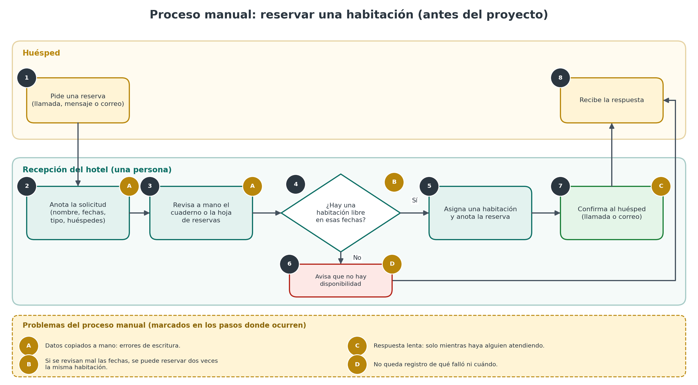


### 2.2 Proceso automatizado

Cómo cambia con n8n: la copia manual, la revisión de datos, la búsqueda de cruces y la detección de duplicados las hace el flujo en segundos; la persona solo interviene cuando hay un incidente técnico registrado.


## 3. Funcionamiento de la solución

### 3.1 Recorrido de una solicitud, paso a paso

|#|Paso|Dónde ocurre|Qué pasa|
|---|---|---|---|
|1|El huésped envía el Google Form|Google|Apps Script (activador _Al enviar el formulario_) hace un POST JSON con la cabecera `X-API-Key`|
|2|Llega al Webhook|`Webhook - Reserva`|n8n comprueba la clave. Si falta o es incorrecta, responde **403** y el flujo no inicia|
|3|Se toma el cuerpo|`Extraer solicitud`|Deja en el item solo el `body` del POST (o `{}` si no hay)|
|4|Limpieza y validación|`Llamar a Preparar solicitud`|El subworkflow devuelve `valido`, `errores` y los datos normalizados|
|5|Primera decisión|`¿Datos completos?`|`valido === true` → continúa. Si no → `Responder 400`|
|6|Disponibilidad|`Llamar a Consultar disponibilidad`|El subworkflow lee Baserow y devuelve `disponible`, `duplicada`, `motivo`, `habitacion`|
|7|Segunda decisión|`¿Hay habitación?`|`disponible === true` → crear. Si no → `Sin disponibilidad` → `Responder 409`|
|8|Crear la reserva|`Crear reserva`|POST a la tabla `Reservas` con estado `Confirmada`|
|9|Confirmar|`Confirmacion` → `Responder 200`|Arma el mensaje y lo devuelve con código 200|

### 3.2 Qué activa el proceso y qué datos recibe

- **Disparador:** petición `POST` a la ruta `/webhook/reserva-hotel` (producción) o `/webhook-test/reserva-hotel` (prueba), con autenticación por cabecera `X-API-Key`.
- **Cuerpo esperado (JSON):**

|Campo|Obligatorio|Tipo / formato|Ejemplo|
|---|---|---|---|
|`nombre`|Sí|Texto no vacío|`"Ana Prueba"`|
|`email`|Sí|Formato `algo@dominio.ext`|`"ana.prueba@example.com"`|
|`fecha_entrada`|Sí|`AAAA-MM-DD`, fecha existente|`"2026-12-10"`|
|`fecha_salida`|Sí|`AAAA-MM-DD`, posterior a la entrada|`"2026-12-12"`|
|`huespedes`|Sí|Entero > 0 (acepta número o texto numérico)|`2` o `"2"`|
|`tipo_habitacion`|Sí|Texto no vacío; debe coincidir con el `Tipo` de la tabla `Habitaciones`|`"Doble"`|
|`id_envio`|No|Lo manda el formulario; **no se usa todavía**|—|

### 3.3 Limpieza, transformación y validación (`Hotel - Sub - Preparar solicitud`)

- **Responsabilidad única:** convertir la solicitud cruda en datos limpios y decir si son válidos. **No toca Baserow.**
- **Entrada:** los campos de la tabla anterior en la raíz del item.
- **Salida:**

|Campo|Contenido|
|---|---|
|`valido`|`true` o `false`|
|`errores`|Lista de mensajes (vacía si es válido)|
|`Cliente`|`nombre` sin espacios sobrantes|
|`Email`|`email` en minúsculas y sin espacios|
|`Entrada`, `Salida`|Fechas tal cual si tienen formato válido|
|`Huespedes`|Número entero (0 si no es válido)|
|`Tipo`|`tipo_habitacion` sin espacios sobrantes|
|`Noches`|Diferencia en días; 0 si las fechas no son válidas|

|Regla|Mensaje cuando falla|
|---|---|
|Nombre no vacío|`nombre es obligatorio`|
|Email con formato válido|`email no es valido`|
|Fechas con formato y existencia reales (se rechaza 2026-02-31)|`fecha_entrada debe tener formato AAAA-MM-DD` / `fecha_salida ...`|
|Salida posterior a entrada|`fecha_salida debe ser posterior a fecha_entrada`|
|Huéspedes entero mayor que 0|`huespedes debe ser un entero mayor que 0`|
|Tipo no vacío|`tipo_habitacion es obligatorio`|

**Decisión de diseño:** un dato mal escrito **no lanza un error**; el subworkflow termina bien con `valido: false`. Es una respuesta del negocio (400), no una falla técnica, y por eso no genera incidente.

### 3.4 Consulta de disponibilidad (`Hotel - Sub - Consultar disponibilidad`)

- **Responsabilidad única:** decidir si hay habitación libre, si la solicitud ya existe o si no hay disponibilidad. **Solo lee** (dos GET a Baserow).
- **Recibe:** `Tipo`, `Entrada`, `Salida`, `Huespedes`, `Email` (el principal le pasa el item que salió de Preparar solicitud).
- **Devuelve:**

| Campo                                          | Significado                                                    |
| ---------------------------------------------- | -------------------------------------------------------------- |
| `disponible`                                   | `true` si hay habitación libre                                 |
| `duplicada`                                    | `true` si ya existe la misma reserva                           |
| `motivo`                                       | `DISPONIBLE`, `SIN_DISPONIBILIDAD` o `RESERVA_DUPLICADA`       |
| `habitacion`                                   | Número de habitación asignada o ya reservada; `null` si no hay |
| `reserva_existente_id`                         | `id` de la reserva repetida; `null` si no aplica               |
| `habitaciones_revisadas`, `reservas_revisadas` | Cuántas filas leyó (útil para diagnóstico)                     |

**Lógica del nodo `Determinar disponibilidad`:**

1. Junta las filas de **todas** las páginas de cada consulta. Si la respuesta no trae `results`, falla con `RESPUESTA_INESPERADA`; si quedaron páginas sin leer, falla con `PAGINACION_INCOMPLETA` (se prefiere fallar a decidir con datos incompletos).
2. Se queda solo con las reservas con `Estado = Confirmada`.
3. **Duplicado:** misma persona (email), mismas fechas y habitación del tipo pedido → `duplicada: true`.
4. **Ocupación:** una habitación está ocupada si `Entrada_reserva < Salida_pedida` **y** `Salida_reserva > Entrada_pedida`.
5. Asigna la **primera habitación libre** ordenando por número.

### 3.5 Reglas de cada ruta del principal

| Ruta               | Condición                                      | Resultado                                                                            | Código                      | ¿Genera incidente? |
| ------------------ | ---------------------------------------------- | ------------------------------------------------------------------------------------ | --------------------------- | ------------------ |
| Clave inválida     | Falta `X-API-Key` o es incorrecta              | n8n rechaza antes de iniciar el flujo                                                | 403                         | No                 |
| Datos inválidos    | `valido !== true`                              | `{ ok: false, error: "DATOS_INCOMPLETOS", mensaje: "Faltan datos o son invalidos" }` | 400                         | No                 |
| Sin disponibilidad | `disponible` falso y `duplicada` falso         | `mensaje`: _No hay habitaciones tipo X disponibles para esas fechas_                 | 409                         | No                 |
| Duplicada          | `duplicada` verdadero                          | `mensaje`: _Ya existe la reserva #N con los mismos datos_ + `reserva_existente_id`   | 409                         | No                 |
| Reserva creada     | `disponible` verdadero                         | `mensaje`: _Reserva confirmada #id para Cliente en la habitación N_                  | 200                         | No                 |
| Falla técnica      | Una API no responde, credencial inválida, etc. | La ejecución falla; el manejador registra el incidente                               | n8n (la 503 está pendiente) | **Sí**             |

> **Importante:** el cuerpo del 400 no incluye la lista `errores` que produce el subworkflow, solo un mensaje general. Es una mejora posible.

### 3.6 Dónde se consulta, crea y actualiza información

|Operación|Nodo|Tabla Baserow|
|---|---|---|
|Leer (GET)|`Consultar habitaciones` (subworkflow)|`Habitaciones`|
|Leer (GET)|`Consultar reservas` (subworkflow)|`Reservas`|
|Crear (POST)|`Crear reserva` (principal)|`Reservas`|
|Crear (POST)|`Guardar incidente en Baserow` (manejador)|`Incidencias`|
|Actualizar|—|No hay actualizaciones ni borrados|

---

## 4. Integraciones y configuración

### 4.1 Servicios externos

|Servicio|Para qué se usa|Cómo se conecta|
|---|---|---|
|**Google Forms + Apps Script**|Entrada de las solicitudes; `UrlFetchApp` envía el POST|Externo a n8n; llama al Webhook|
|**Baserow (API REST)**|Base de datos: `Habitaciones`, `Reservas`, `Incidencias`. Lectura y escritura|**HTTP Request** con credencial _Header Auth_|
|**Cloudflare Tunnel + puente**|Hace alcanzable el n8n local desde Google durante la demo|Fuera de n8n|

**Nodos nativos vs HTTP Request:** todo el acceso a Baserow se hace con **HTTP Request** (por eso hay que documentar cada llamada). Los nodos nativos se usan para el Webhook, los Edit Fields, los IF, `Execute Workflow`, `Code`, `Respond to Webhook`, `Error Trigger` y `Stop and Error`.

### 4.2 Llamadas HTTP Request a Baserow

**Base de la URL:** `https://api.baserow.io/api/database/rows/table/<ID_TABLA>/` (los IDs de los JSON son de la cuenta del equipo; hay que reemplazarlos).

|Nodo|Método|Tabla (ID en JSON)|Parámetros / cuerpo enviados|Datos relevantes de la respuesta|
|---|---|---|---|---|
|`Consultar habitaciones`|GET|`Habitaciones` (1227774)|Query: `user_field_names=true`, `filter__Tipo__equal=<Tipo>`, `filter__Activa__boolean=true`, `size=100`|`results[]` con `Numero`, `Tipo`, `Activa`; `next`|
|`Consultar reservas`|GET|`Reservas` (1227779)|Query: `user_field_names=true`, `size=100`|`results[]` con `id`, `Email`, `Entrada`, `Salida`, `Habitacion`, `Estado`; `next`|
|`Crear reserva`|POST|`Reservas` (1227779)|Query: `user_field_names=true`. Cuerpo JSON: `Cliente`, `Email`, `Entrada`, `Salida`, `Noches`, `Huespedes`, `Habitacion`, `Estado: "Confirmada"`|La fila creada, incluido su `id`|
|`Guardar incidente en Baserow`|POST|`Incidencias` (1284431)|Query: `user_field_names=true`. Cuerpo: `Fecha`, `Proyecto`, `Workflow`, `Ejecucion_ID`, `Ejecucion_URL`, `Nodo`, `Solicitud_Ref`, `Mensaje`, `Estado`|La fila creada, incluido su `id`|

**Paginación** (en las dos lecturas): modo _Response contains next URL_, `nextURL = {{ $response.body.next }}`, termina cuando `!$response.body.next`, con un máximo de 50 peticiones (`size=100` por página → hasta 5.000 filas). Si aún quedara una página, el código falla con `PAGINACION_INCOMPLETA`.

**Reintentos:** `Consultar habitaciones`, `Consultar reservas` y `Guardar incidente en Baserow` tienen _Retry on fail_ con 2 segundos de espera (número de intentos: el predeterminado de n8n). **`Crear reserva` no tiene reintentos a propósito:** repetir una escritura podría duplicar la reserva.

### 4.3 Credenciales y permisos (sin valores)

|Credencial en n8n|Tipo|Dónde se usa|Qué debe contener|
|---|---|---|---|
|`Baserow hotel`|Header Auth|Todos los HTTP Request|Cabecera `Authorization` con valor `Token <su_token_de_baserow>`|
|`clave-webhook-hotel`|Header Auth|Nodo `Webhook - Reserva`|Cabecera `X-API-Key` con una clave propia|

**Permisos:** el token de Baserow necesita **lectura y escritura** sobre las tres tablas. Los JSON guardan solo el **nombre y el ID interno** de cada credencial, no su valor; después de importar hay que seleccionar de nuevo las credenciales propias.

### 4.4 Recursos que debe preparar quien configure su copia

**Tabla `Habitaciones`**

|Columna|Tipo recomendado|Nota|
|---|---|---|
|`Numero`|Texto|Se compara y ordena como texto numérico|
|`Tipo`|**Texto**|El filtro `equal` funciona sobre texto; con lista de selección no funcionaría|
|`Activa`|Booleano|**Obligatoria**: el filtro `Activa = true` la usa|

Cargar al menos una habitación activa por tipo (en las pruebas: dos tipo `Doble`, la 102 y la 201).

**Tabla `Reservas`**

|Columna|Tipo recomendado|Nota|
|---|---|---|
|`Cliente`, `Email`|Texto||
|`Entrada`, `Salida`|Fecha (formato ISO, sin hora)|El código las compara como texto `AAAA-MM-DD`|
|`Noches`, `Huespedes`|Número||
|`Habitacion`|Texto||
|`Estado`|**Texto**|Debe valer exactamente `Confirmada`; con lista de selección el valor llegaría como objeto y no coincidiría|
|`Tipo`, `Evento_ID`|Texto|Opcionales; el flujo actual **no** las llena|

**Tabla `Incidencias`:** columnas de texto `Fecha` (primaria), `Proyecto`, `Workflow`, `Ejecucion_ID`, `Ejecucion_URL`, `Nodo`, `Solicitud_Ref`, `Mensaje` (texto largo) y `Estado`.


### 4.5 Webhook

|Aspecto|Detalle|
|---|---|
|Método|`POST`|
|Ruta|`reserva-hotel`|
|URL de **prueba**|`http://localhost:5678/webhook-test/reserva-hotel` (solo después de pulsar _Listen for test event_ en el nodo; atiende una petición y se apaga)|
|URL de **producción**|`http://localhost:5678/webhook/reserva-hotel` (requiere el workflow **publicado/activo**)|
|Autenticación|Header Auth: cabecera `X-API-Key`|
|Modo de respuesta|`Using 'Respond to Webhook' node` (responde el nodo `Responder 200/400/409`)|
|Respuestas|200, 400, 409; 403 lo devuelve n8n si falla la autenticación|

**Cómo probarlo (datos ficticios):**

```bash
curl -i -X POST "http://localhost:5678/webhook-test/reserva-hotel" \
  -H "Content-Type: application/json" \
  -H "X-API-Key: <su_clave>" \
  -d '{
    "nombre": "Ana Prueba",
    "email": "ana.prueba@example.com",
    "fecha_entrada": "2026-12-10",
    "fecha_salida": "2026-12-12",
    "huespedes": 2,
    "tipo_habitacion": "Doble"
  }'
```


### 4.6 Túnel y puente (solo demostración)

Google no puede llegar a un n8n que corre en `localhost`, por eso la demo usa dos piezas:

- **`puente_reservas.cjs`** (en `documentacion/puente/puente.zip`): servidor Node.js que escucha en `127.0.0.1:5681` y **solo deja pasar `POST /webhook/reserva-hotel`** con JSON (máximo 10 KB, 30 peticiones por minuto, 15 s de espera a n8n). Todo lo demás recibe 404. Reenvía únicamente la cabecera `X-API-Key`.
- **Cloudflare Tunnel:** debe apuntar al puerto **5681 (el puente)**, **nunca al 5678**, para no exponer el editor de n8n.

Inicio: `node puente_reservas.cjs` y después iniciar el túnel hacia el puerto 5681 `[COMPLETAR: comando exacto que usaron]`. **La dirección del túnel es temporal:** puede cambiar cada vez que se inicia o dejar de funcionar; hay que actualizarla en el script de Apps Script. Al terminar las pruebas, cerrar el túnel y el puente.

**Script:**

```javascript

// Puente de laboratorio: Google Forms -> n8n local

// Solo deja pasar: POST /webhook/reserva-hotel con JSON.

// Todo lo demas (editor, test URL, otras rutas) recibe 404.

// Escucha solo en 127.0.0.1; el tunel apunta aqui, NUNCA al puerto 5678.

  
const http = require('http');


const PUERTO_PUENTE = 5681;

const N8N_HOST = '127.0.0.1';

const N8N_PUERTO = 5678;

const RUTA_PERMITIDA = '/webhook/reserva-hotel';

const MAX_BYTES = 10 * 1024;      // 10 KB

const MAX_POR_MINUTO = 30;        // limite simple de peticiones

const TIMEOUT_N8N_MS = 15000;

  

let ventanaInicio = Date.now();

let contador = 0;

  

function responder(res, codigo, obj) {

  const cuerpo = JSON.stringify(obj);

  res.writeHead(codigo, {

    'Content-Type': 'application/json; charset=utf-8',

    'Content-Length': Buffer.byteLength(cuerpo)

  });

  res.end(cuerpo);

}

  

const servidor = http.createServer((req, res) => {

  const ruta = (req.url || '').split('?')[0];

  

  // 1. Solo POST a la ruta exacta

  if (req.method !== 'POST' || ruta !== RUTA_PERMITIDA) {

    return responder(res, 404, { ok: false, error: 'NO_ENCONTRADO' });

  }

  

  // 2. Limite de peticiones por minuto

  const ahora = Date.now();

  if (ahora - ventanaInicio > 60000) { ventanaInicio = ahora; contador = 0; }

  if (++contador > MAX_POR_MINUTO) {

    return responder(res, 429, { ok: false, error: 'DEMASIADAS_PETICIONES' });

  }

  

  // 3. Debe ser JSON

  const tipo = (req.headers['content-type'] || '').toLowerCase();

  if (!tipo.startsWith('application/json')) {

    return responder(res, 415, { ok: false, error: 'SOLO_JSON' });

  }

  

  // 4. Leer el cuerpo con limite de tamano

  const trozos = [];

  let total = 0;

  let cortado = false;

  req.on('data', (t) => {

    total += t.length;

    if (total > MAX_BYTES) {

      cortado = true;

      responder(res, 413, { ok: false, error: 'CUERPO_MUY_GRANDE' });

      req.destroy();

      return;

    }

    trozos.push(t);

  });

  

  req.on('end', () => {

    if (cortado) return;

    const crudo = Buffer.concat(trozos).toString('utf8');

  

    // 5. Debe ser un objeto JSON valido

    let datos;

    try { datos = JSON.parse(crudo); } catch (e) { datos = null; }

    if (!datos || typeof datos !== 'object' || Array.isArray(datos)) {

      return responder(res, 400, { ok: false, error: 'JSON_INVALIDO' });

    }

  

    // 6. Reenviar a n8n con solo las cabeceras necesarias

    const cabeceras = {

      'Content-Type': 'application/json',

      'Content-Length': Buffer.byteLength(crudo)

    };

    if (req.headers['x-api-key']) cabeceras['X-API-Key'] = req.headers['x-api-key'];

  

    const salida = http.request(

      { host: N8N_HOST, port: N8N_PUERTO, path: RUTA_PERMITIDA, method: 'POST',

        headers: cabeceras, timeout: TIMEOUT_N8N_MS },

      (respN8n) => {

        const partes = [];

        respN8n.on('data', (p) => partes.push(p));

        respN8n.on('end', () => {

          const cuerpo = Buffer.concat(partes);

          res.writeHead(respN8n.statusCode || 502, {

            'Content-Type': respN8n.headers['content-type'] || 'application/json',

            'Content-Length': cuerpo.length

          });

          res.end(cuerpo);

        });

      }

    );

    salida.on('timeout', () => { salida.destroy(); responder(res, 504, { ok: false, error: 'N8N_TARDO_DEMASIADO' }); });

    salida.on('error', () => responder(res, 502, { ok: false, error: 'N8N_NO_RESPONDE' }));

    salida.write(crudo);

    salida.end();

  });

});

  

servidor.listen(PUERTO_PUENTE, '127.0.0.1', () => {

  console.log('Puente listo en http://127.0.0.1:' + PUERTO_PUENTE);

  console.log('Solo acepta: POST ' + RUTA_PERMITIDA);

});
```

## 5. Errores y recuperación

### 5.1 Tres situaciones distintas

|Situación|Ejemplo|Cómo se trata|Respuesta|Incidente|
|---|---|---|---|---|
|**Dato inválido o incompleto**|Email mal escrito, salida antes de entrada|`valido: false` → `¿Datos completos?` → `Responder 400`|400|No|
|**Regla del negocio no se cumple**|No hay habitación libre, o la reserva ya existe|`¿Hay habitación?` falso → `Sin disponibilidad` → `Responder 409`|409|No|
|**Falla técnica**|Baserow no responde, token vencido, respuesta sin `results`, paginación incompleta|La ejecución falla, se activa el manejador|La que genere n8n (la **503** está pendiente)|**Sí**|

Distinción clave: _no tener disponibilidad_ es una respuesta correcta del sistema; _no poder consultar Baserow_ es un error técnico.

### 5.2 Manejador de errores (`Hotel - Manejador de errores`)

Se ejecuta **automáticamente** cuando falla un workflow al que está asociado (no lo llama otro workflow). Se asocia en _Settings → Error workflow_.

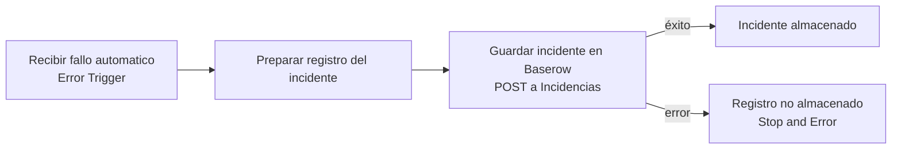

|Campo guardado|Origen|Para qué sirve|
|---|---|---|
|`Fecha`|`$now.toISO()`|Cuándo ocurrió|
|`Proyecto`|Texto fijo `Reservas Hotel`|Identificar el proceso|
|`Workflow`|`workflow.name`|Qué workflow falló|
|`Ejecucion_ID`, `Ejecucion_URL`|`execution.id`, `execution.url`|Abrir el detalle técnico|
|`Nodo`|`execution.lastNodeExecuted`|Dónde falló|
|`Solicitud_Ref`|Texto `[ref=...]` dentro del mensaje (ver 7.6)|Relacionar el incidente con una solicitud sin guardar datos personales|
|`Mensaje`|`execution.error.message`, máximo 500 caracteres|Qué pasó|
|`Estado`|Texto fijo `pendiente_revision`|Pendiente de atención|

**Qué hace y qué no:**

- **Sí:** guarda una fila en la tabla `Incidencias` de Baserow. Ese es el único registro del fallo. Si no puede guardarla, la propia ejecución del manejador queda en rojo (nodo `Registro no almacenado`), localizable en _Executions_.
- **No:** no repara, no reanuda la ejecución que falló y no responde al cliente del Webhook.
- **No envía ningún aviso** por correo ni mensajería. **Preparar un objeto en un nodo no es haber enviado una notificación**; en este proyecto no hay notificaciones (propuesto, no implementado).

**Convención de `[ref=...]`:** el Error Trigger no recibe los datos del negocio. Se diseñó que el workflow principal escriba `[ref=<Tipo> <Entrada>..<Salida>]` en el mensaje del error para que el manejador lo extraiga. **Hoy el principal no genera esa marca** (no tiene ruta de error propia), así que en un fallo real `Solicitud_Ref` quedará como `no_disponible`. La extracción solo se comprobó con un fallo simulado (M-01).

### 5.3 Reintentos configurados

|Nodo|Reintentos|Motivo|
|---|---|---|
|`Consultar habitaciones`, `Consultar reservas`|Sí, espera 2 s|Una lectura repetida es segura|
|`Guardar incidente en Baserow`|Sí, espera 2 s|Es preferible una fila repetida a un incidente perdido|
|`Crear reserva`|**No**|Una escritura repetida podría duplicar la reserva|

### 5.4 Cómo recuperar una operación sin duplicar registros

1. Abrir la fila en `Incidencias` (Estado `pendiente_revision`) y usar `Ejecucion_URL` para ver el detalle de la ejecución que falló.
2. Resolver la causa (credencial, servicio caído, tabla mal configurada).
3. **Reenviar la misma solicitud** al Webhook. El flujo no reanuda lo anterior: empieza de nuevo.
4. La protección contra duplicados es la regla de `Determinar disponibilidad`: si la reserva **sí** se había creado antes del fallo, el reenvío recibe **409 con `reserva_existente_id`** y no se crea otra; si **no** se había creado, se crea normalmente.
5. Cambiar manualmente el `Estado` del incidente a un valor de cierre (por ejemplo `resuelto`) `[COMPLETAR: acordar los valores de estado]`.

**Límites de esta protección:** compara email + fechas + tipo; no usa `id_envio`; y no hay bloqueo entre la consulta y la creación, por lo que dos solicitudes simultáneas idénticas podrían, en teoría, crear dos reservas. Una fila de incidente puede repetirse si se reintenta la escritura; se distinguen por `Ejecucion_ID`.

---

## 6. Importación y puesta en marcha

**Versión de n8n:** 2.37.10 (local) `[verificar en Settings → About]`.

### 6.1 Orden de importación (`Workflows → ⋯ → Import from file`)

|Orden|Archivo|Nombre del workflow|
|---|---|---|
|1|`workflows/Hotel_Manejador_de_errores.json`|Hotel - Manejador de errores|
|2|`workflows/Hotel_Sub_Preparar_solicitud.json`|Hotel - Sub - Preparar solicitud|
|3|`workflows/Hotel_Sub_Consultar_disponibilidad.json`|Hotel - Sub - Consultar disponibilidad|
|4|`workflows/Hotel.json`|Hotel (principal)|

### 6.2 Ajustes después de importar

- [ ] Crear las dos credenciales (sección 4.3) y seleccionarlas en cada HTTP Request y en el Webhook.
- [ ] En el principal, en `Llamar a Preparar solicitud` y `Llamar a Consultar disponibilidad`, **volver a elegir** los subworkflows importados (los IDs cambian en cada instancia).
- [ ] Reemplazar los IDs de tabla de Baserow (1227774, 1227779, 1284431) por los de su base.
- [ ] En _Settings → Error workflow_ del principal y de los dos subworkflows, elegir `Hotel - Manejador de errores`.
- [ ] Revisar que los nodos `Recibir del principal` de los subworkflows tengan _Input data mode: Accept all data_; los datos fijados (pinned) de prueba se pueden borrar.
- [ ] Publicar/activar el workflow principal para usar la URL de producción.
- [ ] Actualizar la URL en Apps Script con la del túnel actual.

### 6.3 Ejecución: prueba vs funcionamiento habitual

|Modo|Pasos|
|---|---|
|**Prueba**|Abrir el principal → _Listen for test event_ en `Webhook - Reserva` → enviar el `curl` a `/webhook-test/reserva-hotel` → revisar la salida en n8n y la fila en `Reservas`|
|**Habitual (demo)**|Publicar el principal → `node puente_reservas.cjs` → iniciar el túnel al puerto 5681 → enviar el formulario. Al terminar, cerrar el túnel y el puente|

No hay programación automática (_Schedule_) en este proyecto, por lo que no hay nada que detener salvo el túnel y el puente.

---

## 7. Expresiones importantes explicadas

### 7.1 Extraer el cuerpo (`Extraer solicitud`)

```
{{ $json.body ?? {} }}
```

El Webhook entrega `headers`, `params`, `query` y `body`. Esta expresión deja solo el `body`; si no hay, un objeto vacío (el flujo seguirá y responderá 400).

|Entrada|Salida|
|---|---|
|`{ "headers": {...}, "body": { "nombre": "Ana", ... } }`|`{ "nombre": "Ana", ... }`|
|`{ "headers": {...} }` (sin body)|`{}`|

### 7.2 Validar que una fecha exista

```javascript
const fechaValida = (v) => /^\d{4}-\d{2}-\d{2}$/.test(v) &&
  new Date(v + 'T00:00:00Z').toISOString().slice(0, 10) === v;
```

Primero comprueba el formato y luego que la fecha **exista**: si JavaScript la corrige (el 31 de febrero se vuelve 3 de marzo), el texto resultante no coincide con el original y se rechaza.

|Entrada|Salida|
|---|---|
|`"2026-12-10"`|`true`|
|`"2026-02-31"`|`false`|
|`"10/12/2026"`|`false`|

### 7.3 Calcular noches

```javascript
Math.round((new Date(salida) - new Date(entrada)) / 86400000)
```

Resta las fechas en milisegundos y divide entre los milisegundos de un día (86 400 000).

|Entrada|Salida|
|---|---|
|entrada `2026-12-10`, salida `2026-12-12`|`2`|
|fechas inválidas|`0` (se asigna `0` sin calcular)|

### 7.4 Regla de cruce de fechas

```javascript
r.Entrada < salida && r.Salida > entrada
```

Una reserva existente choca con la solicitada si empieza **antes** de que ella termine **y** termina **después** de que ella empiece.

|Reserva existente|Solicitud|Resultado|
|---|---|---|
|20→23 oct|20→23 oct|Ocupada (20<23 y 23>20)|
|20→23 oct|23→25 oct|**Libre** (20<25, pero 23>23 es falso): se puede entrar el día que otro sale|

### 7.5 Detección de reserva duplicada

```javascript
String(r.Email || '').toLowerCase() === email &&
r.Entrada === entrada && r.Salida === salida &&
numerosDelTipo.includes(String(r.Habitacion))
```

Es duplicada si hay una reserva confirmada con el mismo email (sin importar mayúsculas), las mismas fechas y una habitación del tipo pedido.

|Entrada|Salida|
|---|---|
|Misma persona y fechas de la reserva #39|`duplicada: true`, `reserva_existente_id: 39`|

### 7.6 Extraer la referencia del incidente

```
{{ (String($json.execution?.error?.message || '').match(/\[ref=([^\]]*)\]/) || [])[1] || 'no_disponible' }}
```

Busca en el mensaje del error el texto `[ref=...]` y se queda con lo que hay dentro de los corchetes.

|Entrada (mensaje de error)|Salida (`solicitud_ref`)|
|---|---|
|`ERROR_TECNICO en "Llamar a Consultar disponibilidad": timeout [ref=Doble 2026-12-10..2026-12-12]`|`Doble 2026-12-10..2026-12-12`|
|`Error cualquiera`|`no_disponible`|

### 7.7 Mensaje de la rama sin disponibilidad

```
{{ $json.duplicada
   ? 'Ya existe la reserva #' + $json.reserva_existente_id + ' con los mismos datos'
   : 'No hay habitaciones tipo ' + $('Llamar a Preparar solicitud').first().json.Tipo + ' disponibles para esas fechas' }}
```

Un solo nodo atiende los dos casos que llevan al 409 y elige el texto según `duplicada`.

|Entrada|Salida|
|---|---|
|`duplicada: true`, `reserva_existente_id: 39`|`Ya existe la reserva #39 con los mismos datos`|
|`duplicada: false`, tipo `Suite Imperial`|`No hay habitaciones tipo Suite Imperial disponibles para esas fechas`|

### 7.8 Paginación de Baserow

```
nextURL:  {{ $response.body.next }}
termina:  {{ !$response.body.next }}
```

Baserow devuelve en `next` la URL de la siguiente página, o `null` en la última. n8n la sigue hasta que sea `null` (máximo 50 peticiones).

---

## 8. Pruebas y evidencias

### 8.1 Resumen

| Tipo                                                   | ID          | Estado                            |
| ------------------------------------------------------ | ----------- | --------------------------------- |
| Caso normal (subworkflow)                              | P-01        | Realizada, con evidencia          |
| Entrada no válida (subworkflow)                        | P-02        | Realizada, con evidencia          |
| Disponibilidad                                         | D-01 a D-05 | Realizadas, con evidencia         |
| Manejador: mapeo con fallo simulado                    | M-01        | Realizada (simulada)              |
| Manejador: escritura en `Incidencias`                  | M-02        | Con evidencia en Baserow          |
| Manejador: falla el propio registro                    | M-03        | Con evidencia de la ruta de error |
| **Extremo a extremo por Webhook** (200, 400, 409, 403) | E-01 a E-06 | **Por ejecutar y documentar**     |
| **Fallo técnico real del flujo principal**             | E-07        | **Por ejecutar y documentar**     |

### 8.2 Subworkflow `Preparar solicitud`

**Tipo de ejecución:** manual, con datos fijos en `Webhook - Reserva` (_Edit output_), ejecutando solo hasta el IF `¿Datos completos?`. No hubo petición HTTP real ni escritura en Baserow.

#### P-01 · Solicitud válida con datos sucios

|Dato|Detalle|
|---|---|
|**Entrada**|`nombre`: `" Ana Prueba "`, `email`: `"ANA.PRUEBA@Example.com"`, entrada `2026-12-10`, salida `2026-12-12`, `huespedes`: `"2"` (texto), `tipo_habitacion`: `"Doble"`|
|**Pasos**|Pegar el JSON en `Webhook - Reserva` → _Execute step_ en `¿Datos completos?` → revisar la salida de `Llamar a Preparar solicitud`|
|**Esperado**|`valido: true`, `errores: []`, nombre sin espacios, email en minúsculas, `Huespedes: 2` (número), `Noches: 2`, IF por la rama **true**|
|**Observado**|`valido: true`, `errores: []`, `Cliente: "Ana Prueba"`, `Email: "ana.prueba@example.com"`, `Huespedes: 2`, `Noches: 2`, rama **true**|
|**Conclusión**|Correcto: limpia espacios, normaliza el email y convierte los huéspedes a número|

```json
[{ "headers": {}, "params": {}, "query": {},
   "body": { "nombre": " Ana Prueba ", "email": "ANA.PRUEBA@Example.com",
             "fecha_entrada": "2026-12-10", "fecha_salida": "2026-12-12",
             "huespedes": "2", "tipo_habitacion": "Doble" } }]
```

| P-01                          |
| ----------------------------- |
| 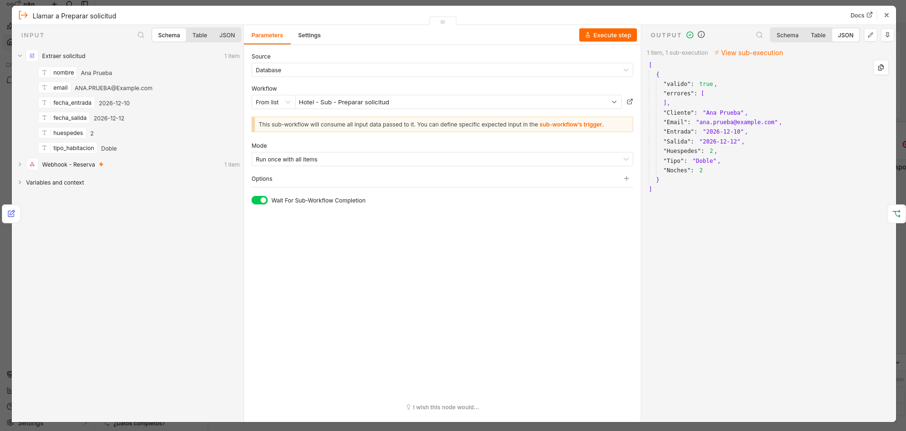 |

#### P-02 · Entrada no válida (cuatro errores a la vez)

|Dato|Detalle|
|---|---|
|**Entrada**|`nombre`: `" "`, `email`: `"no-es-email"`, entrada `2026-12-12`, salida `2026-12-10`, `huespedes`: `0`, tipo `"Doble"`|
|**Pasos**|Igual que P-01 con este JSON|
|**Esperado**|`valido: false` y cuatro mensajes en `errores`; IF por la rama **false**|
|**Observado**|`valido: false`; errores: «nombre es obligatorio», «email no es valido», «fecha_salida debe ser posterior a fecha_entrada», «huespedes debe ser un entero mayor que 0»; rama **false**|
|**Conclusión**|Correcto. Informa todos los problemas juntos. No es un error técnico: el subworkflow termina bien|

```json
[{ "headers": {}, "params": {}, "query": {},
   "body": { "nombre": "   ", "email": "no-es-email",
             "fecha_entrada": "2026-12-12", "fecha_salida": "2026-12-10",
             "huespedes": 0, "tipo_habitacion": "Doble" } }]
```

| P-02                                |
| ----------------------------------- |
| 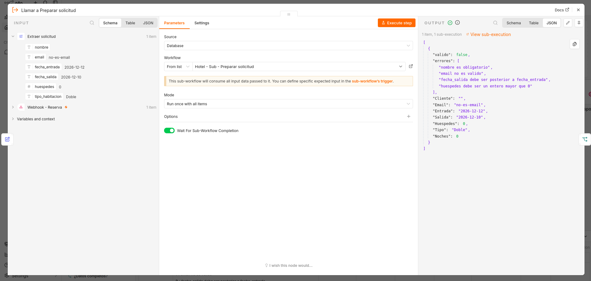 |

**Qué no demuestran:** una respuesta HTTP 400 recibida por un cliente real. Tampoco se probó cada regla por separado.

### 8.3 Subworkflow `Consultar disponibilidad`

**Tipo de ejecución:** manual, con datos fijos en `Recibir del principal`. Solo lectura (GET): ninguna prueba creó ni modificó registros. En todas, salvo D-04, la consulta revisó 2 habitaciones `Doble` (102 y 201) y 8 reservas.

| ID   | Caso                         | Entrada (ficticia)                                                   | Esperado                                            | Observado                                                             | Conclusión                                        |
| ---- | ---------------------------- | -------------------------------------------------------------------- | --------------------------------------------------- | --------------------------------------------------------------------- | ------------------------------------------------- |
| D-01 | Fechas libres                | `Doble`, 2026-12-10 → 12-12, 2 huéspedes, `prueba.nueva@example.com` | `disponible: true`, habitación `102`                | `disponible: true`, `DISPONIBLE`, `"102"`                             | Asigna la primera habitación libre                |
| D-02 | Cruce con reservas           | `Doble`, 2026-10-20 → 10-23                                          | Habitación `201` (la 102 está ocupada por #6 y #39) | `disponible: true`, `"201"`                                           | Salta la habitación ocupada                       |
| D-03 | Reserva repetida             | Mismas fechas que D-02 y el email de la reserva #39                  | `duplicada: true`, `reserva_existente_id: 39`       | `RESERVA_DUPLICADA`, `reserva_existente_id: 39`                       | Detecta la repetición y no propone crear otra     |
| D-04 | Tipo sin habitaciones        | `Suite Imperial`, 2026-12-10 → 12-12                                 | `disponible: false`, `SIN_DISPONIBILIDAD`           | `SIN_DISPONIBILIDAD`, `habitacion: null`, `habitaciones_revisadas: 0` | Respuesta del negocio: termina sin error          |
| D-05 | Entrada el día que otro sale | `Doble`, 2026-10-23 → 10-25                                          | `disponible: true`, `102` (la #6 sale el 23)        | `DISPONIBLE`, `"102"`                                                 | La regla permite entrar el mismo día de la salida |

**Pasos para repetir:** abrir `Hotel - Sub - Consultar disponibilidad` → en `Recibir del principal` usar _Edit output_ y pegar la entrada → _Execute workflow_ → comparar la salida de `Determinar disponibilidad`.

```json
[{ "Tipo": "Doble", "Entrada": "2026-10-20", "Salida": "2026-10-23", "Huespedes": 2, "Email": "prueba.nueva@example.com" }]
```

(Cambiar `Tipo`, fechas y `Email` según el caso; D-03 usa el email de la reserva #39.)

| D-01                            |
| ------------------------------- |
| 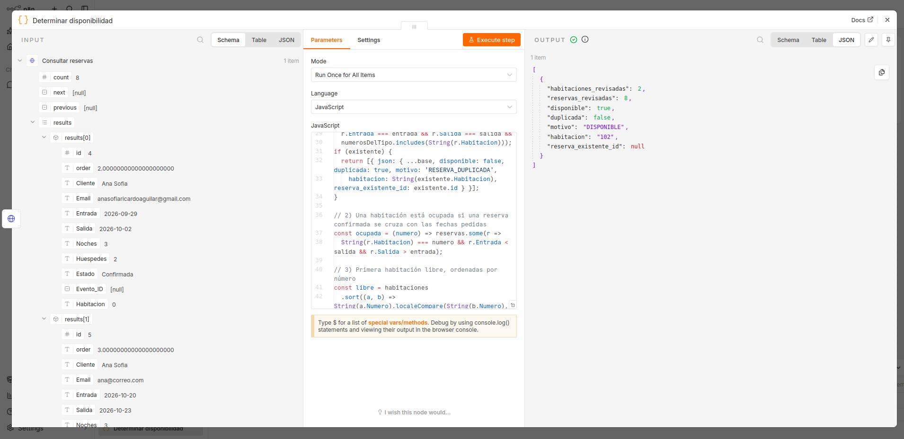 |
| D-02                            |
|  |
| D-03                            |
| 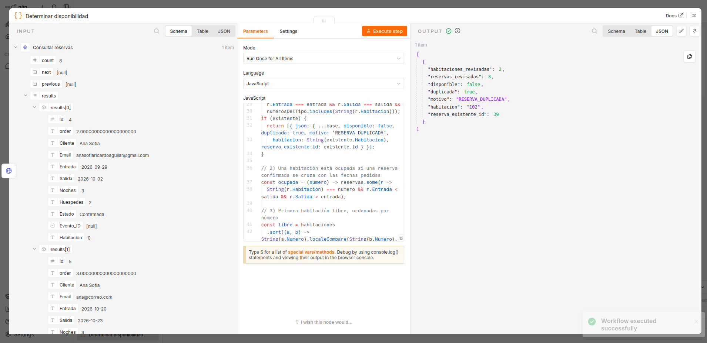 |
| D-04                            |
| 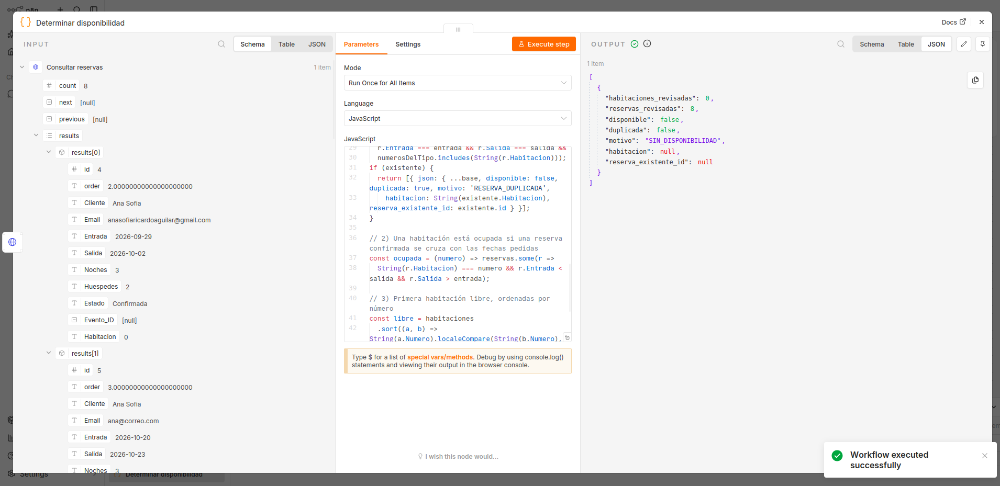 |
| D-05                            |
| 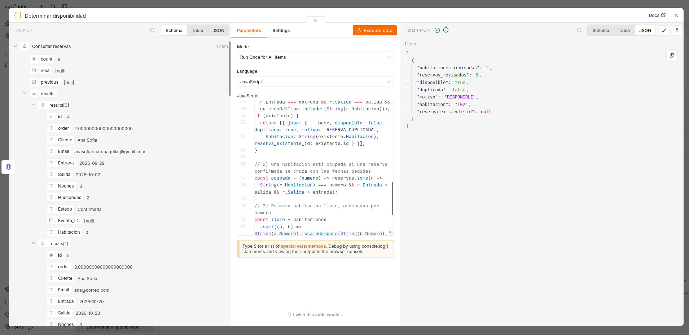 |

**Qué demuestran:** la lógica de decisión frente a los datos reales de las tablas.
**Qué no:** una petición real por el Webhook ni la creación de una reserva.

### 8.4 Manejador de errores

| ID   | Caso                                             | Entrada                                                                                                                                                                                     | Esperado                                                                     | Observado                                                                                                            | Evidencia                                               | Conclusión                                                                                                |
| ---- | ------------------------------------------------ | ------------------------------------------------------------------------------------------------------------------------------------------------------------------------------------------- | ---------------------------------------------------------------------------- | -------------------------------------------------------------------------------------------------------------------- | ------------------------------------------------------- | --------------------------------------------------------------------------------------------------------- |
| M-01 | Mapeo del incidente (manual, fallo **simulado**) | JSON ficticio cargado con _Edit output_ en `Recibir fallo automatico` (sección 5.2 y JSON pinneado en el workflow): `execution.id: "231"`, mensaje con `[ref=Doble 2026-12-10..2026-12-12]` | Los 9 campos del incidente; `solicitud_ref` = `Doble 2026-12-10..2026-12-12` | Coincide; `solicitud_ref` salió limpio                                                                               | M-01<br><br>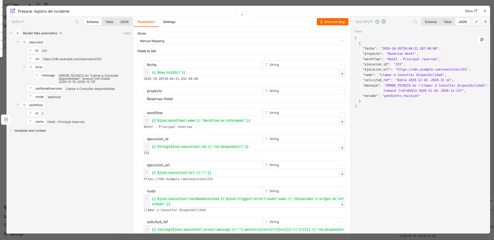<br>      | Correcto. **No** demuestra que el Error Trigger se active ante un fallo real                              |
| M-02 | Escritura persistente en `Incidencias`           | Salida de M-01                                                                                                                                                                              | Una fila nueva en Baserow con los mismos valores                             | Fila #3 en la tabla `Incidencias` con `Workflow`, `Ejecucion_ID` 231, `Solicitud_Ref` y `Estado: pendiente_revision` | M-02<br>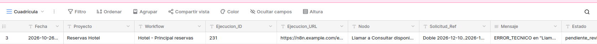<br><br>       | Correcto. La evidencia está en Baserow, no solo en el OUTPUT de n8n. Los datos son simulados              |
| M-03 | Falla el propio registro                         | Credencial o tabla inválida a propósito, en una copia                                                                                                                                       | El flujo toma la salida de error y `Registro no almacenado` queda en rojo    | La captura muestra la ruta de error y `Registro no almacenado` marcado como fallido                                  | M-03<br><br>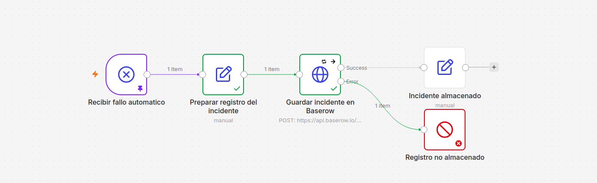<br><br> | Correcto en el canvas. `[COMPLETAR: añadir captura de Executions con la ejecución del manejador en rojo]` |

**Pasos M-01:** abrir el manejador → en `Recibir fallo automatico` usar _Edit output_ y pegar el JSON → _Execute step_ en `Preparar registro del incidente` → comparar con lo esperado. Para M-02, continuar con `Guardar incidente en Baserow` y abrir la tabla.

### 8.5 Pruebas extremo a extremo por el Webhook (por ejecutar)

> Estas pruebas completan los mínimos de la guía (caso normal real, entrada no válida real y fallo técnico controlado real). **Ejecútenlas con una copia de trabajo y completen las columnas «Observado» y «Evidencia»** antes de entregar. Usen la URL de prueba (`/webhook-test/...`) o la de producción con el workflow activo.

| ID   | Caso                                 | Entrada                                                                                                                                                       | Esperado                                                                                                                                                                                                                                                                                  | Observado     | Evidencia                                                                           |
| ---- | ------------------------------------ | ------------------------------------------------------------------------------------------------------------------------------------------------------------- | ----------------------------------------------------------------------------------------------------------------------------------------------------------------------------------------------------------------------------------------------------------------------------------------- | ------------- | ----------------------------------------------------------------------------------- |
| E-01 | **Caso normal real**                 | `curl` de la sección 4.5 (Ana Prueba, Doble, 10→12 dic)                                                                                                       | **200** con `Reserva confirmada #<id> para Ana Prueba en la habitación 102`; una fila nueva en `Reservas` con `Noches: 2`, `Estado: Confirmada`                                                                                                                                           | `[COMPLETAR]` | `evidencias/E01_Caso_Normal.png` + `evidencias/E01_Fila_Reservas.png`               |
| E-02 | **Entrada no válida real**           | Mismo `curl` con `"email": "no-es-email"`                                                                                                                     | **400** con `error: DATOS_INCOMPLETOS`; **ninguna** fila nueva en `Reservas`                                                                                                                                                                                                              | `[COMPLETAR]` | `evidencias/E02_Entrada_No_Valida.png`                                              |
| E-03 | Sin clave                            | Mismo `curl` sin la cabecera `X-API-Key`                                                                                                                      | **403**; el flujo no inicia (no aparece ejecución)                                                                                                                                                                                                                                        | `[COMPLETAR]` | `evidencias/E03_Sin_Clave_403.png`                                                  |
| E-04 | Sin disponibilidad                   | `"tipo_habitacion": "Suite Imperial"`                                                                                                                         | **409** con _No hay habitaciones tipo Suite Imperial..._                                                                                                                                                                                                                                  | `[COMPLETAR]` | `evidencias/E04_Sin_Disponibilidad_409.png`                                         |
| E-05 | Fechas que se cruzan                 | Mismo tipo y fechas de una reserva existente, con **otro** email, hasta ocupar todas las habitaciones del tipo                                                | **409** sin disponibilidad                                                                                                                                                                                                                                                                | `[COMPLETAR]` | `evidencias/E05_Cruce_409.png`                                                      |
| E-06 | **Reserva duplicada / recuperación** | Repetir E-01 exactamente                                                                                                                                      | **409** con `Ya existe la reserva #<id>`; **no** aparece una segunda fila                                                                                                                                                                                                                 | `[COMPLETAR]` | `evidencias/E06_Duplicada_409.png`                                                  |
| E-07 | **Fallo técnico controlado real**    | En una **copia**, con el principal activo y el manejador asociado, invalidar a propósito la credencial de `Consultar habitaciones` y enviar el `curl` de E-01 | La ejecución falla; el manejador guarda una fila en `Incidencias` con `Workflow`, `Nodo` y `Ejecucion_ID` correctos. **`Solicitud_Ref` = `no_disponible`** (el principal aún no escribe `[ref=...]`). Ninguna fila nueva en `Reservas`. Respuesta HTTP de error generada por n8n (no 503) | `[COMPLETAR]` | `evidencias/E07_Fila_Incidencias_Real.png` + `evidencias/E07_Ejecucion_Fallida.png` |

> El Error Trigger solo se dispara en ejecuciones **automáticas** (workflow activo y petición a la URL de producción), no al ejecutar a mano desde el editor.

**E-01 caso normal**

> **[IMAGEN PENDIENTE — `evidencias/E01_Caso_Normal.png`]** Respuesta 200 del Webhook (terminal o Postman, con los datos ficticios).

**E-01 fila en Reservas**

> **[IMAGEN PENDIENTE — `evidencias/E01_Fila_Reservas.png`]** La fila creada en la tabla `Reservas` de Baserow, con la habitación asignada y `Noches: 2`. Esta captura es la que demuestra el almacenamiento (no basta el OUTPUT de n8n).

**E-02 entrada no válida**

> **[IMAGEN PENDIENTE — `evidencias/E02_Entrada_No_Valida.png`]** Respuesta 400 + tabla `Reservas` sin fila nueva.

**E-06 duplicada**

> **[IMAGEN PENDIENTE — `evidencias/E06_Duplicada_409.png`]** Respuesta 409 de la repetición + `Reservas` con una sola fila.

**E-07 incidente real**

> **[IMAGEN PENDIENTE — `evidencias/E07_Fila_Incidencias_Real.png`]** Fila nueva en `Incidencias` generada por un fallo real, junto con la ejecución fallida en _Executions_.

---

## 9. Evolución y estado final

### 9.1 Qué cambió desde el primer corte

| Antes (primer corte)                                                                                                                                                               | Ahora (segundo corte)                                                                                |
| ---------------------------------------------------------------------------------------------------------------------------------------------------------------------------------- | ---------------------------------------------------------------------------------------------------- |
| Un workflow principal                                                                                                                                                              | Un workflow principal y tres workflows de apoyo                                                      |
| El flujo consultaba habitaciones y asignaba **la primera del tipo**, sin revisar reservas (aún quedan restos de ese diseño en las expresiones de `Crear reserva` y `Confirmacion`) | Subworkflow de disponibilidad con **regla de cruce de fechas** y detección de duplicados             |
| Validación básica                                                                                                                                                                  | Subworkflow con limpieza, normalización y 6 reglas                                                   |
| Sin entrada externa                                                                                                                                                                | Webhook con clave + Google Form + Apps Script                                                        |
| Sin tratamiento de errores                                                                                                                                                         | Manejador de errores que guarda incidentes; reintentos en lecturas; falla ante paginación incompleta |
| Sin seguridad de entrada                                                                                                                                                           | Autenticación por cabecera y puente que solo deja pasar una ruta                                     |

### 9.2 Decisiones técnicas importantes

- **Subworkflows con una responsabilidad:** uno valida (sin tocar servicios), otro decide disponibilidad (solo lee). El principal solo coordina y responde.
- **`valido: false` en lugar de lanzar un error:** un dato malo del huésped no es una falla técnica.
- **Reintentos en lecturas, no en la escritura:** evita reservas duplicadas.
- **Fallar antes que decidir con datos incompletos:** si quedan páginas sin leer, el flujo se detiene.
- **El túnel apunta al puente (5681), no a n8n (5678):** para no exponer el editor.
- **Referencia sin datos personales** en el incidente: tipo y fechas, no nombre ni correo.

### 9.3 Dificultades encontradas y cómo se resolvieron

| Dificultad                                                                               | Solución                                                                    |
| ---------------------------------------------------------------------------------------- | --------------------------------------------------------------------------- |
| Reservas que ya ocupaban la misma habitación (#6 y #39 en la 102) no se tenían en cuenta | Se agregó la lectura de `Reservas` y la regla de cruce (prueba D-02)        |
| Google no puede llegar a `localhost`                                                     | Túnel + puente restrictivo (solo laboratorio)                               |
| El Error Trigger no recibe datos del negocio                                             | Convención `[ref=...]` en el mensaje (pendiente de generar en el principal) |

### 9.4 Aportes de los integrantes

|Integrante|Aporte|
|---|---|
|Ana Sofia Ricardo|Workflows, pruebas de disponibilidad y manejo de errores|
|Mariana Valencia Henao|Bitácora y documentación|
|Luis Fernando Velasquez|Bitácora y documentación|
|Juan Martin Garcia|Presentación y diagramas|

### 9.5 Herramientas de apoyo e IA

Para el desarrollo de este proyecto se utilizaron las herramientas de inteligencia artificial **ChatGPT** y **Claude**, empleadas exclusivamente como asistentes en la **redacción, estructuración y refinamiento de las bitácoras**.

Para garantizar la precisión y validez de la información generada por estas herramientas, se aplicaron los siguientes mecanismos de verificación:

- **Revisión manual de contenido:** Se contrastó minuciosamente cada bitácora redactada para asegurar que reflejara fielmente el trabajo técnico real realizado en el proyecto.
- **Validación de consistencia técnica:** Se verificó que los términos, pasos y flujos descritos coincidieran exactamente con la ejecución real de los nodos y el comportamiento esperado del sistema.
- **Corrección de estilo:** Se auditaron las respuestas de la IA para eliminar posibles alucinaciones o datos genéricos, asegurando un tono técnico, honesto y coherente con la documentación del proyecto.

### 9.6 Estado final: implementado, simulado y propuesto

**Implementado (existe en los JSON entregados)**

| Funcionalidad                                                                       | Estado de comprobación                                                                                                                     |
| ----------------------------------------------------------------------------------- | ----------------------------------------------------------------------------------------------------------------------------------------- |
| Webhook POST con autenticación por cabecera (403 si falla)                          | Configurado; prueba E-03 pendien                                                                                                           |
| Limpieza y validación en subworkflow                                                | **Comprobado** (P-01, P-                                                                                                                   |
| Consulta de disponibilidad con cruce de fechas, duplicados, paginación y reintentos | **Comprobado** (D-01 a D                                                                                                                   |
| Respuestas 400 y 409                                                                | Configuradas; pruebas E-02, E-04, E-06 pendi                                                                                               |
| Manejador de errores con registro en `Incidencias`                                  | **Comprobado** con fallo simulado (M-01, M-02,                                                                                             |
| Creación de la reserva y respuesta 200                                         **No comprobado.** Con el JSON actual, las referencias a nodos inexistentes impiden que funcione hasta corregirlas (ver notas del equipo) equipo) |

** Simulado**

- El fallo que alimenta al manejador en M-01 y M-02 (datos ficticios cargados a mano).
- Acceso desde Google mediante túnel y puente: es un montaje de laboratorio, no un servicio permanente.

** Propuesto (no implementado)**

- Respuesta **503** al cliente cuando falle un servicio externo, y escritura de `[ref=...]` en el mensaje del error.
- Integración con **Google Calendar** y uso del campo `Evento_ID`.
- **Notificaciones** al huésped o al personal.
- Uso de `id_envio` para idempotencia y protección contra solicitudes simultáneas.
- Validación de **capacidad** según huéspedes.
- Incluir la lista `errores` en la respuesta 400.
- Modificar y cancelar reservas.
- Filtrar las reservas en Baserow por fechas en lugar de leer toda la tabla.

### 9.7 Limitaciones conocidas

- Solo corre en n8n local; el túnel es temporal.
- La disponibilidad se calcula solo con la tabla `Reservas`; si alguien edita la tabla a mano, el flujo lo refleja, pero no hay otra fuente (como un calendario).
- La coincidencia de `Tipo` depende de cómo esté escrito en la tabla `Habitaciones`; no se probó con diferencias de mayúsculas.
- El historial de _Executions_ depende de la retención configurada en n8n; no es un archivo permanente.
- El manejador registra, no repara.

---

## 10. Anexo: lista de imágenes del documento

| Imagen                                                          | Estado            | Sección | Qué debe mostrar                  |
| --------------------------------------------------------------- | ----------------- | ------- | --------------------------------- |
| `diagramas/Proceso_Manual.png`                                  | En el repositorio | 2.1     | Proceso manual                    |
| `diagramas/Proceso_Automatizado.png`                            | En el repositorio | 2.2     | Proceso automatizado              |
| `evidencias/Caso_Normal_Preparar.png`                           | En el repositorio | 8.2     | P-01                              |
| `evidencias/Entrada_No_Valida_Preparar.png`                     | En el repositorio | 8.2     | P-02                              |
| `evidencias/D01_Fechas_Libres.png` … `D05_Salida_Mismo_Dia.png` | En el repositorio | 8.3     | D-01 a D-05                       |
| `evidencias/M01_Mapeo_Incidente.png`                            | En el repositorio | 8.4     | M-01                              |
| `evidencias/M02_Fila_Incidencias.png`                           | En el repositorio | 8.4     | M-02                              |
| `evidencias/M03_Registro_No_Almacenado.png`                     | En el repositorio | 8.4     | M-03                              |
| `evidencias/Baserow_Estructura_Tablas.png`                      | Pendiente         | 4.4     | Las tres tablas con sus columnas  |
| `evidencias/Webhook_Configuracion.png`                          | Pendiente         | 4.5     | Nodo Webhook configurado          |
| `evidencias/Formulario_y_AppsScript.png`                        | Pendiente         | 4.6     | Formulario y activador            |
| `evidencias/E01_Caso_Normal.png`                                | Pendiente         | 8.5     | Respuesta 200                     |
| `evidencias/E01_Fila_Reservas.png`                              | Pendiente         | 8.5     | Fila creada en `Reservas`         |
| `evidencias/E02_Entrada_No_Valida.png`                          | Pendiente         | 8.5     | Respuesta 400                     |
| `evidencias/E03_Sin_Clave_403.png`                              | Pendiente         | 8.5     | Respuesta 403                     |
| `evidencias/E04_Sin_Disponibilidad_409.png`                     | Pendiente         | 8.5     | Respuesta 409 sin disponibilidad  |
| `evidencias/E05_Cruce_409.png`                                  | Pendiente         | 8.5     | 409 por cruce                     |
| `evidencias/E06_Duplicada_409.png`                              | Pendiente         | 8.5     | 409 por duplicada                 |
| `evidencias/E07_Fila_Incidencias_Real.png`                      | Pendiente         | 8.5     | Incidente real                    |
| `evidencias/E07_Ejecucion_Fallida.png`                          | Pendiente         | 8.5     | Ejecución fallida en _Executions_ |

